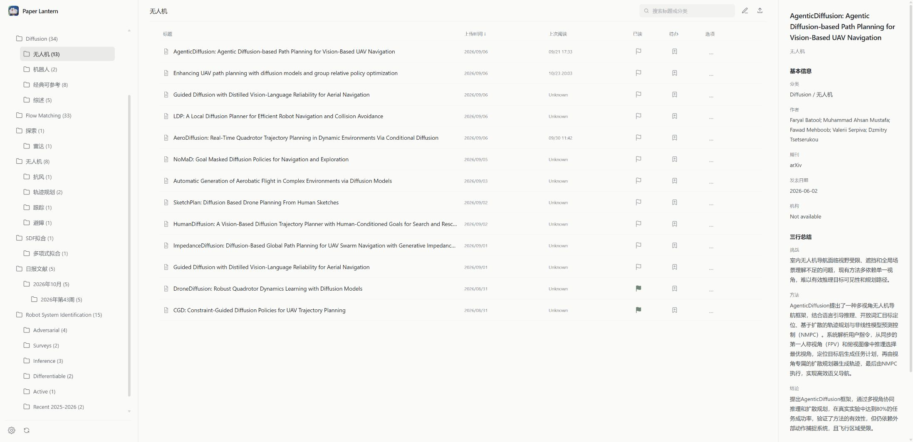
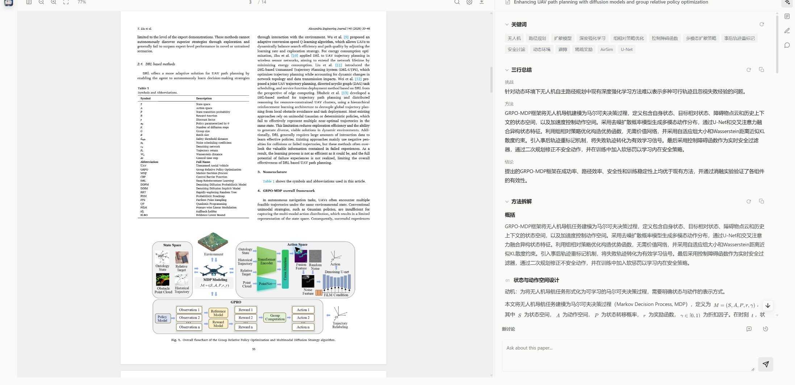
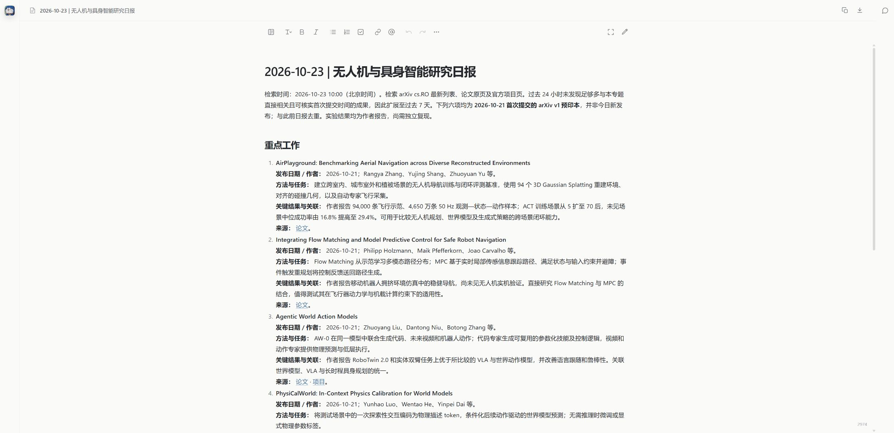

# Paper Lantern

本地优先、开源的论文阅读与文献管理工具。把论文收集、PDF 阅读、AI 解析、批注和研究笔记放在同一个工作区。

[使用指南](doc/usage.md) · [API 说明](doc/api.md) · [浏览器扩展](extension/README.md) · [Research MCP](plugins/paper-lantern-research-mcp/README.md) · [开发说明](doc/development.md)

## 文献管理：从收集到整理

支持上传或拖入本地 PDF、通过 PDF 链接和 arXiv 导入，也能使用 Chrome / Edge 扩展从浏览器发送论文。

- **层级分类与多分类归属**：同一篇论文或笔记可归入多个主题，共享内容与阅读记录；重复导入同一 PDF 时合并分类归属。
- **搜索与排序**：按标题或分类搜索，按标题、上传时间、上次阅读时间整理列表。
- **阅读进度管理**：通过“最近”“待办”和已读标记安排阅读。
- **信息预览与引用**：在文献库预览论文信息和三行总结，复制 GB/T 7714、BibTeX、RIS、APA、MLA、IEEE 格式引用。

## PDF 阅读与 AI 解析

在双栏工作区中对照论文原文与 AI 解析，支持 PDF 目录、全文搜索、缩放和页码跳转。

- **结构化解析**：生成关键词及解释、基本信息、三行摘要、方法概览、逐项方法拆解和结论。
- **划词阅读**：选中文字即可高亮、评论、翻译或结合全文解释。
- **多线程讨论**：围绕论文持续追问，保存不同讨论线程与历史，支持流式回答。
- **自选模型服务**：支持兼容 OpenAI Chat Completions 的接口，可自定义模型与 AI 提示词。

## Markdown 笔记与研究整理

边读边记，也可以创建独立于论文的笔记，用于整理专题、研究日报或阶段报告。

- **Markdown 编辑器**：支持公式、表格、任务列表与自动保存。
- **文献关联**：在笔记中插入文献库中的论文，点击链接返回阅读器。
- **笔记讨论**：围绕笔记内容与 AI 讨论，继续梳理观点和问题。
- **导出与分享**：导出带批注的 PDF，或将 Markdown 笔记导出为 PDF。

## 本地存储与同步

论文、元数据、笔记、批注和讨论记录保存在本机，支持同步到本地文件夹或 WebDAV，便于配合网盘、NAS、坚果云和 Nextcloud 使用。支持手动同步及库变更后自动同步。

核心阅读、分类、笔记与批注功能无需配置 AI。使用 AI 功能时，相关文本会发送到你配置的模型服务，并可能产生费用；PDF 导出需要额外依赖。安装、配置、数据迁移和常见问题见[使用指南](doc/usage.md)。

## Research MCP：组合你的研究工作流

将 Paper Lantern 的 Research MCP 接口接入支持 MCP 的 AI 客户端后，你可以直接用自然语言描述研究任务，AI 客户端会根据你的指令自动调用工具，搜索本地文献、导入论文、创建分类、整理笔记，并将成果保存到 Paper Lantern，供你继续阅读、批注和更新。结合客户端自身的联网检索与定时任务能力，还可以让资料收集和整理自动衔接起来，例如下面两种用法。

### 让研究日报自己积累起来

结合 AI 客户端的联网检索与定时任务，每天追踪你关心的方向，核对来源、与已有记录去重，再通过 Research MCP 把结果写成独立笔记，按年月和周归档。例如，持续关注无人机与具身智能，把每天值得读的论文、关键方法和待跟进问题留在同一个文献库中。定时与检索由 AI 客户端提供，笔记则可以随时打开、补充和关联原文。

### 从一个问题整理出专题报告

也可以从一个具体问题开始尝试：比如“Flow Matching 在无人机中有哪些应用？”让 AI 客户端检索资料，导入可获取的论文，按研究方向分类、标记待读，再把技术路线、实验依据和局限整理成一篇带有库内论文链接的报告。读完原文后，你还可以继续补充批注，让报告随着理解和新资料一起更新。

MCP 提供了搜索、导入、分类、读写笔记等可以自由组合的工具。你可以从自己的一个重复动作出发：把本周笔记汇成组会提纲，按待办论文生成阅读计划，或为同一问题建立持续更新的方法对照表。试着把你的目标、筛选标准和希望保存的结果告诉 AI 客户端，再逐步调整成适合自己的研究流程。更多组合方式可以从 [Research MCP 工具文档](plugins/paper-lantern-research-mcp/README.md)开始探索。

## 扩展与集成

| 入口 | 能力 | 文档 |
| --- | --- | --- |
| 浏览器扩展 | 导入当前 PDF、arXiv 页面或网页中的 PDF 链接 | [安装与使用](extension/README.md) |
| HTTP API | 访问文献库、导入任务、分类、笔记、AI 与同步功能 | [API 说明](doc/api.md) |
| 开发与定制 | 修改提示词，了解模块结构并运行检查 | [开发说明](doc/development.md) |

## 开始使用

请从[使用指南](doc/usage.md)开始，了解运行环境、启动方式、AI 配置与日常操作。

本项目采用 [MIT License](LICENSE)。
