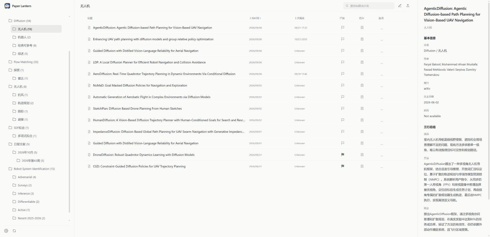
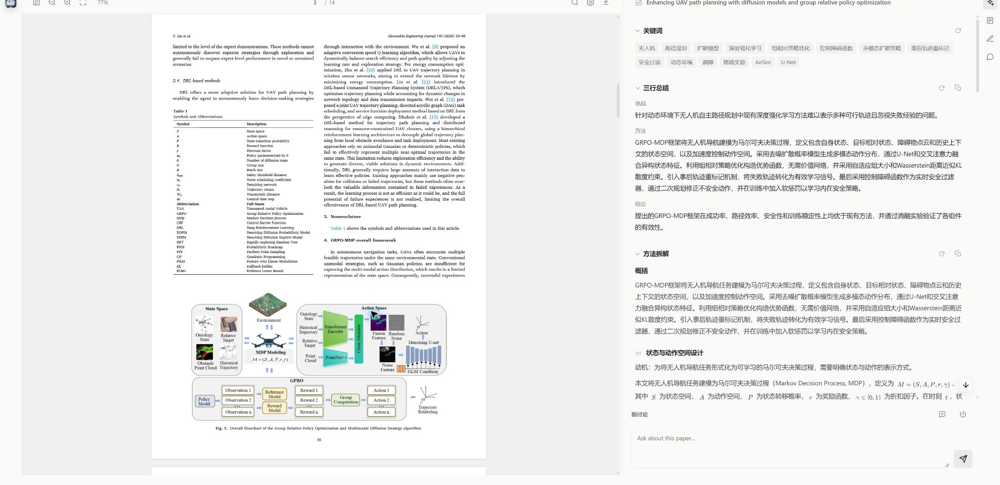
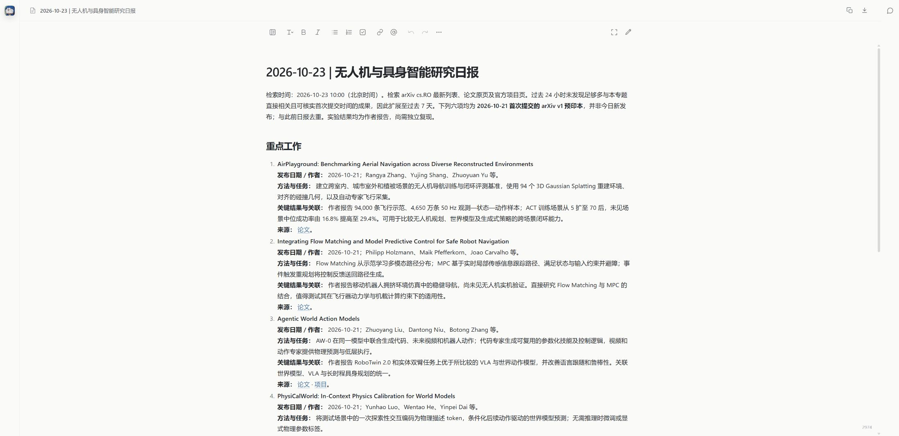
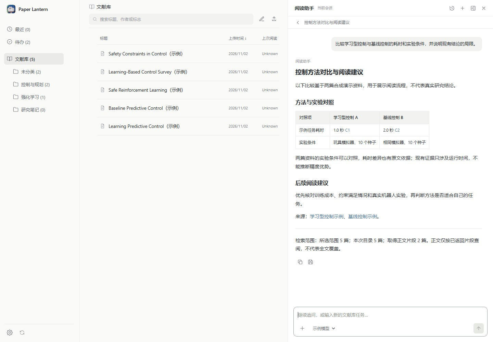

# Paper Lantern

本地优先、开源的论文阅读与文献管理工具。把论文收集、PDF 阅读、AI 解析、批注和研究笔记放在同一个工作区。

[使用指南](doc/usage.md) · [阅读 Agent](doc/reading-agent.md) · [API 说明](doc/api.md) · [浏览器扩展](extension/README.md) · [Research MCP](plugins/paper-lantern-research-mcp/README.md) · [开发说明](doc/development.md)

## 文献管理：从收集到整理

支持上传或拖入本地 PDF、通过 PDF 链接和 arXiv 导入，也能使用 Chrome / Edge 扩展从浏览器发送论文。

- **层级分类与多分类归属**：同一篇论文或笔记可归入多个主题，共享内容与阅读记录；重复导入同一 PDF 时合并分类归属。
- **搜索与排序**：按标题或分类搜索，按标题、上传时间、上次阅读时间整理列表。
- **阅读进度管理**：通过“最近”“待办”和已读标记安排阅读。
- **信息预览与引用**：在文献库预览论文信息和三行总结，复制 GB/T 7714、BibTeX、RIS、APA、MLA、IEEE 格式引用。

## PDF 阅读与 AI 解析

在双栏工作区中对照论文原文与 AI 解析，支持 PDF 目录、全文搜索、缩放和页码跳转。

- **结构化解析**：生成关键词及解释、基本信息、三行摘要、方法概览、逐项方法拆解和结论。
- **按目标自主解析**：根据阅读目标自主分析论文、拆解方法，支持单独刷新各项解析结果。
- **划词阅读**：选中文字即可高亮、评论、翻译或结合全文解释。
- **自动高亮重点**：自动挑选并高亮重要原文，保留已有批注，避免重复标注。
- **多线程讨论**：围绕论文持续追问，保存不同讨论线程与历史，支持流式回答。
- **自选模型服务**：自由选择 AI 模型服务，自定义解析与讨论的提示词。

## Markdown 笔记与研究整理

边读边记，也可以创建独立于论文的笔记，用于整理专题、研究日报或阶段报告。

- **Markdown 编辑器**：支持公式、表格、任务列表与自动保存。
- **文献关联**：在笔记中插入文献库中的论文，点击链接返回阅读器。
- **笔记讨论**：围绕笔记内容与 AI 讨论，继续梳理观点和问题。
- **导出与分享**：导出带批注的 PDF，或将 Markdown 笔记导出为 PDF。

## 阅读 Agent：查阅论文与整理文献库

面向文献库的研究助手。用自然语言描述你的问题、目标和要求，Agent 会围绕任务组合文献检索、原文阅读、分析归纳与资料整理等能力，并通过持续对话推进研究。

- **有据可查的回答**：结合摘要与正文回答，附上原文引文与论文链接，方便核对来源。
- **整理前预览确认**：展示整理计划和修改前后内容，支持调整或取消，确认后再更新文献库。
- **持续追问与任务恢复**：保留讨论历史，支持浮窗和侧边停靠；任务可停止、恢复，刷新后仍可继续。
- **保存报告笔记**：将研究回答保存为带有论文链接的笔记，方便继续阅读和补充。

例如，可以让它比较多篇论文的方法与实验、围绕研究问题梳理证据，或为未分类文献提出整理方案。这些只是使用示例，你可以根据自己的研究目标提出任务，并在对话中调整范围、分析角度和成果形式。

## 本地存储与同步

论文、元数据、笔记、批注和讨论记录保存在本机，支持同步到本地文件夹或 WebDAV，便于配合网盘、NAS、坚果云和 Nextcloud 使用。支持手动同步及库变更后自动同步。

核心阅读、分类、笔记与批注功能无需 AI 也能使用。

## Research MCP：组合你的研究工作流

让支持 MCP 的 AI 客户端使用 Paper Lantern 的文献与笔记能力，将文献搜索、论文导入、分类整理、高亮批注和笔记读写组合进你的研究工作流。你可以用自然语言描述目标，由客户端结合自身能力与其他工具完成任务，并将成果保存到 Paper Lantern，供后续阅读和更新。

以下是一些组合使用的例子，具体流程可以按你的研究目标、资料来源和成果要求灵活组织：

- **积累研究日报**：结合 AI 客户端的联网检索与定时任务，追踪研究方向，将值得阅读的论文、关键方法和待跟进问题整理为笔记。
- **生成专题报告**：围绕具体问题收集论文、分类标记，整理方法、实验依据与局限，生成带有论文链接的报告。
- **组织研究成果**：将笔记汇成组会提纲，按待办论文生成阅读计划，或持续更新方法对照表。
- **预览并保存重点**：为待读论文生成重点高亮，预览确认后保存，继续阅读与批注。
