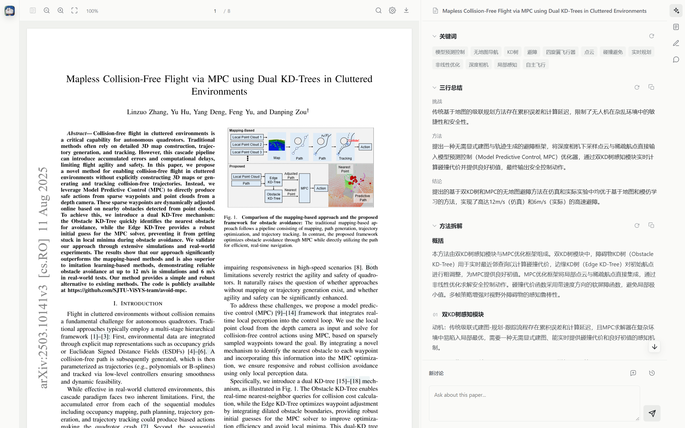

# Paper Lantern

Paper Lantern 是一个本地优先、开源的论文阅读与文献管理工具。论文、笔记、批注和讨论记录都保存在你自己的电脑上，并可按需同步到本地文件夹或 WebDAV。

你可以用它导入和分类论文、阅读 PDF、生成 AI 摘要、翻译或解释选中文本、记录笔记与批注，以及导出带批注的 PDF。



## 快速开始

### Windows 单文件 exe

打包后可直接双击 `dist/PaperLantern.exe`，无需安装 Python。程序会启动本地服务并自动打开默认浏览器；使用期间保留控制台窗口，退出时按 `Ctrl+C` 或关闭该窗口。AI 功能仍需在设置中填写自己的 API Key。

将 exe 放在有写入权限的文件夹中。首次启动会在 exe 旁边创建 `.env/` 配置目录，导入论文后创建 `literature_library/`；这些数据会在退出后保留。打包不会包含工程中已有的密钥或私人文献。需要使用原有数据时，先退出程序，再将原来的 `.env/` 和 `literature_library/` 复制到 exe 旁边；Windows 加密的密钥需在同一 Windows 用户下使用，换电脑请重新填写。

开发者在 Windows 上使用正式版 Python 3.10 或更高版本构建：

```powershell
python build_exe.py
# 指定 Python 路径：
python build_exe.py --python "C:\path\to\python.exe"
```

构建脚本会创建独立环境、安装打包和 PDF/笔记导出依赖，生成单个 `dist/PaperLantern.exe`。网页、前端依赖和 AI 提示词均包含在 exe 中。命令行启动可使用 `--no-browser` 禁用自动打开页面，或使用 `--port 8001` 更换端口；`PAPER_LIBRARY_DIR` 环境变量仍然有效。

### 1. 准备环境

需要：

- Python 3.9 或更高版本
- Chrome、Edge 等现代浏览器
- AI API Key（仅 AI 总结、翻译、解释和讨论等功能需要）

核心阅读和文献管理功能只使用 Python 标准库，无需先安装依赖。

### 2. 启动 Paper Lantern

在项目根目录运行：

```powershell
python server.py
```

然后在浏览器打开：

```text
http://127.0.0.1:8000/
```

> 请通过 `python server.py` 启动，不要直接双击 `index.html`，也不要使用普通静态服务器，否则文献导入、保存和 AI 功能无法使用。

### 3. 配置 AI

打开页面右上角的设置，填写：

- **AI Base URL**：默认为 `https://api.openai.com/v1`
- **AI Model**：默认为 `gpt-4o-mini`
- **AI API Key**：对应模型服务的密钥

Paper Lantern 使用兼容 OpenAI Chat Completions 的接口，因此也可以填写其他兼容服务的地址和模型名称。配置会保存在 `.env/paperlantern_config.json`。

不配置 AI 也可以正常导入、分类和阅读论文，以及使用笔记与批注功能。

## 日常使用

### 导入论文

在文献库首页点击上传入口，可选择以下方式：

- **上传本地 PDF**：选择文件，或把 PDF 拖入上传区域。
- **通过链接导入**：粘贴 PDF 直链、arXiv 摘要页链接或 arXiv PDF 链接。
- **通过浏览器扩展导入**：在网页或 arXiv 页面上一键发送到 Paper Lantern，安装方法见[浏览器扩展](#浏览器扩展可选)。

导入后，可以在首页搜索论文、创建分类，并通过论文卡片菜单管理分类归属或删除论文。

### 管理文献与独立笔记

- 使用分类整理论文和笔记，并按标题、上传时间或上次阅读时间排序。
- 论文和笔记均可同时属于多个分类。在首页条目菜单或阅读器侧栏的条目菜单中选择“分类”，打开“管理分类”窗口，勾选或取消勾选后保存；清空选择会归入“未分类”。
- 拖入分类表示增加归属。移除或调整分类均在“管理分类”窗口中完成；取消原分类并勾选目标分类即可移动归属。删除分类会保留条目的其他归属。
- 全库、父分类、“最近”“待办”和笔记中的文献选择器均按文章 ID 去重；同一 PDF 重复导入会给已有文章增加指定分类。
- 用“已读”和“待办”标记阅读状态；“最近”和“待办”入口可以快速筛选内容。
- 点击首页的“新建笔记”，可创建不依附于论文的 Markdown 笔记，并围绕笔记内容与 AI 讨论。
- 在论文信息区点击 Citation，可复制 GB/T 7714、BibTeX、RIS、APA、MLA 或 IEEE 格式的引用信息。

### 阅读与 AI 解析

点击论文进入阅读器。PDF 显示在左侧，论文信息和阅读工具位于右侧。

- 使用 AI 生成关键词、基本信息、三行摘要、方法概览、方法拆解和结论。
- 点击相应区域的刷新或解析按钮，可重新生成内容。
- 在讨论区围绕当前论文提问；不同讨论线程及其历史会自动保存。
- 扫描版 PDF 通常没有可提取的文字，因此 AI 解析、翻译和解释可能无法正常工作。

AI 请求使用你配置的模型服务，并可能产生对应账号的费用。

### 划词、批注与翻译

在 PDF 中选中文本后，可以：

- 添加高亮；
- 写评论；
- 翻译选中文字；
- 让 AI 解释这段文字在论文中的作用。

高亮、评论和翻译结果会保存在当前论文目录中。需要分享或归档时，可从论文卡片菜单导出带批注的 PDF。

### 写阅读笔记

阅读器内置 Markdown 笔记编辑器，支持公式、表格和任务列表，并会自动保存到当前论文的 `notes.md`。

导出带批注的 PDF 或将 Markdown 笔记导出为 PDF，需要安装额外依赖：

```powershell
pip install pymupdf markdown-it-py matplotlib
```

其中 `matplotlib` 用于渲染 `$...$` 和 `$$...$$` 公式；未安装时，公式会以纯文本输出。

## 同步与备份

在页面右上角的设置中选择同步方式：

- **本地文件夹**：适合网盘客户端目录、移动硬盘或 NAS 挂载目录。
- **WebDAV**：适合坚果云、Nextcloud 等支持 WebDAV 的服务。

配置后，可点击文献库右上角的同步按钮手动同步。开启“库变更后自动同步”后，上传论文、移动分类或保存批注和讨论时会尝试自动同步。

使用坚果云时：

- 填写 WebDAV 地址，例如 `https://dav.jianguoyun.com/dav/PaperLantern`，不要填写分享链接；
- 使用坚果云生成的第三方应用密码，而不是登录密码。

同步内容包含论文 PDF、元数据、笔记、批注、讨论记录和同步索引。请使用可信的私有同步空间。

## 数据存放位置

首次加载旧版分类索引时，会自动升级多分类结构，并在文献库中保留 `library_db.v1.backup.json` 备份。

导入接口 `/api/library/import/start`（以及 `/api/library/remote-pdf`、`/api/library/arxiv`）和新建笔记接口接受 `categoryIds: ["分类A", "分类B"]`；旧的 `category`、`categoryId` 参数仍可使用。本地 PDF 上传 `/api/library/upload` 的 multipart 字段 `categoryIds` 可传 JSON 数组字符串或重复字段。

`POST /api/library/paper` 使用 `id`、`categoryIds` 和 `action` 管理归属：`set_categories` 替换全部归属，`add_categories` 增加归属，`remove_categories` 移除指定归属。空数组配合 `set_categories` 清空归属。响应提供 `categoryIds`、`categoryNames`，并保留单分类兼容字段。

默认文献库位于项目内的 `literature_library/`：

```text
literature_library/
├── library_db.json                  # 分类和文献索引
├── paperlantern-sync-index.json     # 同步索引
└── papers/
    └── <paper-id>/
        ├── paper.pdf                # 原始 PDF
        ├── metadata.json            # 标题、分类、摘要和基本信息
        ├── notes.md                 # Markdown 阅读笔记
        ├── highlights.json          # 高亮、评论和翻译
        ├── discussion.json          # 讨论线程
        └── extracted_text.txt       # PDF 文本缓存
```

如需将文献库放在项目外，可在启动前设置 `PAPER_LIBRARY_DIR`：

```powershell
$env:PAPER_LIBRARY_DIR = "E:\your\paper_library"
python server.py
```

`.env/`、`.cache/` 和 `literature_library/` 已被 Git 忽略，以降低误提交密钥和私人论文的风险。迁移或重装前，仍建议单独备份文献库目录。

## 浏览器扩展（可选）

项目自带 Chrome/Edge 扩展，可导入当前 PDF、arXiv 页面或网页中的 PDF 链接。

1. 先启动 Paper Lantern。
2. 打开浏览器的扩展管理页面，例如 Chrome 的 `chrome://extensions`。
3. 开启“开发者模式”，点击“加载已解压的扩展程序”。
4. 选择项目中的 `extension/` 文件夹。
5. 在 PDF 或 arXiv 页面点击扩展图标，或右键 PDF 链接后选择导入。

扩展默认连接 `http://127.0.0.1:8000`，可在扩展弹窗中修改地址。

## 高级配置

除了在页面中设置，也可以在启动前使用环境变量提供默认值：

```powershell
$env:AI_API_KEY = "sk-your-real-api-key"
$env:AI_MODEL = "gpt-4o-mini"
$env:AI_API_BASE_URL = "https://api.openai.com/v1"
$env:PORT = "8000"
$env:PAPER_LIBRARY_DIR = "E:\your\paper_library"
python server.py
```

同步相关环境变量：

```text
CLOUD_SYNC_PROVIDER=local
CLOUD_SYNC_LOCAL_DIR=E:\paperlantern-sync
CLOUD_SYNC_WEBDAV_URL=https://dav.example.com/PaperLantern
CLOUD_SYNC_WEBDAV_USERNAME=your-user
CLOUD_SYNC_WEBDAV_PASSWORD=your-app-password
CLOUD_SYNC_AUTO_PUSH=true
```

如果修改了 `PORT`，请使用对应端口访问页面，并同步修改浏览器扩展中的服务器地址。

## 常见问题

### 页面可以打开，但无法导入或保存

确认是通过 `python server.py` 启动，并从终端显示的 `http://127.0.0.1:<端口>/` 访问，而不是直接打开 HTML 文件。

### AI 功能提示未配置或请求失败

检查设置中的 Base URL、模型名称和 API Key。Base URL 可以填写服务根地址，也可以填写以 `/chat/completions` 结尾的完整地址。

### PDF 没有文字，无法总结或翻译

当前文字提取依赖 PDF 自带的文本层。扫描版 PDF 需要先通过其他工具完成 OCR。

### 是否适合部署到公网

当前项目面向个人本地使用，没有提供多用户鉴权、权限隔离或公网部署加固，不建议直接暴露到公网。

## 项目结构

```text
.
├── index.html              # 文献库首页
├── reader.html             # PDF 阅读器
├── server.py               # 本地服务
├── prompts/ai/             # 可编辑的 AI 提示词
├── extension/              # 浏览器导入扩展
├── vendor/                 # PDF.js、KaTeX、Vditor 等前端依赖
└── literature_library/     # 默认文献库目录
```

AI 总结、方法拆解和翻译等提示词位于 `prompts/ai/`，可以按自己的阅读习惯修改。
