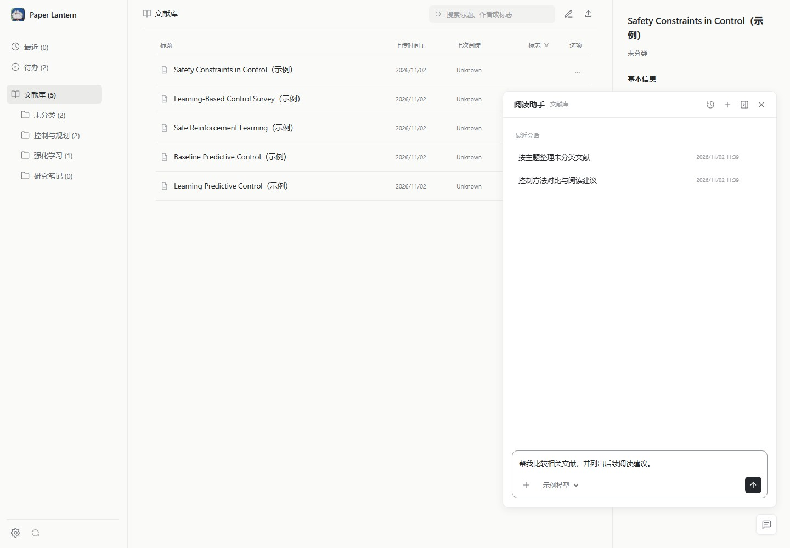
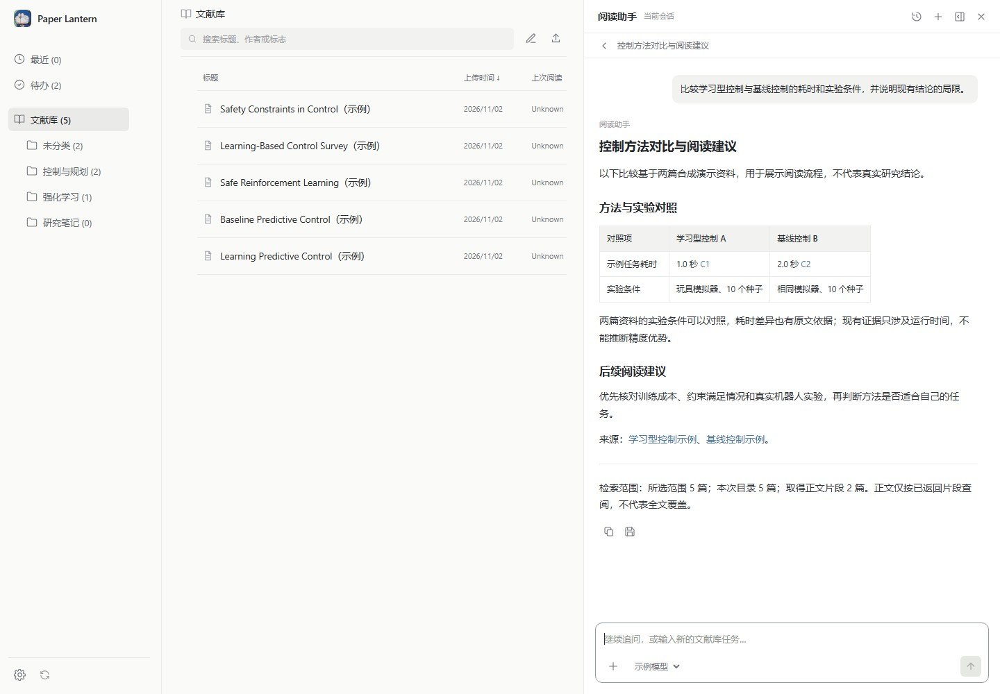
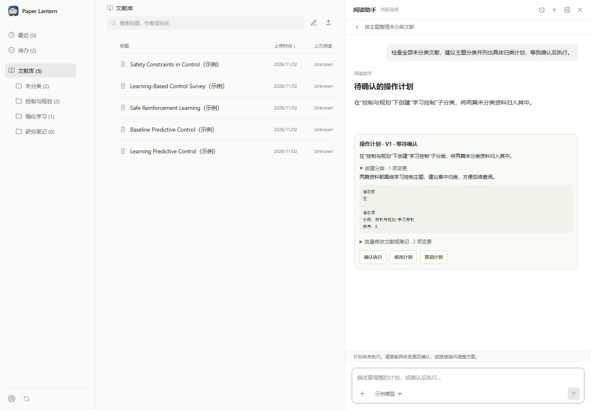

# 阅读 Agent

[返回 README](../README.md) · [使用指南](usage.md#阅读-agent查阅与整理) · [API 说明](api.md#文献库阅读助手) · [开发说明](development.md)

阅读机器人使用 LangGraph 编排，通过官方 MCP Python SDK 调用已有 Research MCP，使用设置中的模型完成文献库查询、整理和带证据的研究汇总。网页任务由通用 Agent 动态选择工具；涉及写入时先生成具体计划，用户确认后由服务端执行。已有研究任务及独立 CLI 继续使用原文证据核验流程。

## 从一个任务开始

先完成下方[依赖安装与模型配置](#安装与运行)，再打开文献库右下角的“阅读助手”。直接输入目标，例如“比较相关文献的实验依据和局限”，或“按研究主题整理未分类论文，先列出计划”。输入框支持 Enter 发送、Shift+Enter 换行，可用“＋”加入重点论文，也可以直接继续追问。



助手按任务选择工具，默认在全部文献库中检索；只有用户用语言明确指定分类时才按该分类及其子分类筛选。调研完成后，回答中的 C1、C2 等编号链接到对应库内文章；悬浮回答可复制正文或保存为笔记。保存使用报告标题，笔记只包含正文及文章链接，不追加“证据与原文”章节。



涉及修改分类、标记、元数据或笔记时，助手会先列出具体计划。展开查看修改前后内容，继续追问可以调整方案；点击“确认执行”才会写入。刷新页面后仍可从历史找回待确认计划。



以上截图来自隔离的合成示例文献库，仅用于说明界面与操作流程，图中的耗时比较不代表真实研究结果。

## 通用任务与确认计划

助手从能力目录中按需发现工具参数，组合查询、阅读和管理能力，不按“整理未分类”等固定意图分支执行。可请求：

- “查看全部未分类论文，建议主题分类，列出归类计划。”
- “将这个分类改名并移动到另一个分类，保留文献的其他归属。”
- “找出某主题的论文，批量标记待办，建立后续阅读笔记。”
- “比较这些论文的方法和实验依据”，交给已有阅读流程查原文、登记结论并校验报告。

当前开放 8 项查询能力和 14 项写能力：概览、分页查找、摘要、全文检索、片段、文献/笔记详情及标记查询；分类创建/改名/移动/删除、分类归属调整、标题及元数据修改、批量更新、标记管理、笔记创建和编辑。删除分类只移除分类及归属，文献仍保留。导入下载、删除文献、永久删除和重复文献合并尚未开放。

查询可直接回答；写操作只会生成计划。计划卡片显示版本、理由和每步修改前后的内容，展开可核对具体文献。支持“确认执行”“修改计划”“取消计划”；修改计划会聚焦发送框，可继续描述调整要求。追问生成新方案后，旧的待确认方案失效。取消计划后通过追问生成新方案，不直接续跑旧计划。助手默认可分页查询整个库，当前页面分类不限制检索；用户明确指定分类时按要求筛选，主动选中或加入的论文仍限定证据调研范围。

计划以具体 ID 冻结对象，可用 `{"ref":"topic.categoryId"}` 引用前一步新分类，同样支持 `flagId` 和 `noteId`。服务端先在内存中模拟全部操作，预览不会创建分类或修改文献；确认仅提交计划 ID 和预览摘要，不接受替换操作。确认前重新校验库版本，库已变化则原计划失效，需要重新预览、确认。重复确认已完成计划只返回原回执。

执行按依赖顺序逐项记账，失败立即停止，已完成操作保留，不提供整份计划的事务回滚。失败或进程中断后，“重新生成预览”只保留未完成步骤，已完成输出转为真实 ID；对可能已部分写入的步骤显示提示，须核对现状并再次确认。重新预览不会自动重试写入。同步失败单独显示，不重做已完成的库操作。

扩展能力时，在 `backend/reading_agent/capabilities.py` 注册工具，并为写工具补齐 `plans.py` 的模拟预览与执行适配及相应测试；模型不会因为 MCP 新增了工具就自动获得其写权限。

## 文献库入口

右下角的机器人图标可拖动，位置保存在本机浏览器中，并随窗口大小限制在可见区域。点击展开“阅读助手”，拖动不会打开；聚焦图标后可按 Shift + 方向键移动。面板内按 Esc 或关闭按钮收起。

输入问题，点击圆形发送按钮或按 Enter 发送，Shift+Enter 换行；中文输入法确认文字不会误发。发送框与论文 discussion 共用圆角输入区样式和控制代码，随内容增高，研究中同一按钮切换为停止。成功创建任务后清空草稿，创建失败时保留输入供重试；查看历史不会自动把旧问题填回发送框。

研究进度由模型在工具调用的同一条回复中给出简短摘要，说明关注的文献或主题、正在比较或核对的内容；等待下一轮分析时继续展示，并附已读文献标题。摘要不读取 `reasoning_content`，也不额外发起模型请求。模型未返回摘要时，按当前问题、候选数量和已读文献显示具体的阶段提示；不把候选目录标为已读。

发送后立即显示问题气泡，当前进度显示在该气泡下方，随对话一起滚动。报告通过模型流式响应逐步显示，生成期间不显示复制和保存操作；报告仍需通过引文与来源校验后才成为最终结果。校验失败会清除该版草稿并重新生成，刷新或重开未完成对话时通过本轮持久化事件恢复内容；同一连接重连从最后事件继续，避免重复追加。

回答结束后可直接在发送框追问，前面的问答保留在同一对话中，刷新或从历史打开会恢复全部轮次。追问默认沿用上一轮文献范围，通过“+”加入论文可改为研究这些论文。每轮使用独立的检查点和检索预算；前文仅作背景，本轮重新读取、登记并校验证据，取消后继续仍沿用该轮预算。模型最多接收最近 8 轮、合计 24000 字符的前文背景，单个问题及回答分别最多取 4000、6000 字符；完整历史仍保存在本机。

研究范围自动使用已选论文，没有选择时默认使用全部文献库，不随当前页面分类变化，不显示范围下拉框。只有用户用语言明确指定分类（如“只检索控制理论分类及其子分类”）时，助手才使用分类筛选。通过发送框左下角“+”搜索并加入论文后，本次范围切为已加入的论文（最多 12 篇），移除全部附件后恢复已选论文或全库范围。右下角模型选择仅更新 `readingAgent` 模块；模型保存中暂停发送，保存失败恢复原选择并保留草稿。支持“比较现有方法的实验依据、优势与局限”和“根据这个想法寻找库内相关文献”等任务。

任务独立于页面连接运行。收起面板、刷新、关闭页面及重启网页服务不会主动取消后台任务；再次打开会恢复当前库的活动任务。阅读助手与论文阅读界面的 discussion 共用标题和历史管理组件：顶部可新建对话、返回列表、行内重命名，历史弹层支持标题搜索、按更新时间排序和删除确认。对话列表显示当前库未删除的历史记录；空白草稿不写入任务库。每个库同时允许一个活动任务。

报告完成后使用与阅读界面相同的 `/api/discussion-title` 生成简短标题，生成失败时保留首问标题。标题单独保存在任务库，不改变原始研究问题或检查点；手动重命名始终优先于晚到的自动标题。删除运行中的对话会同时停止任务，删除后的记录不会因后台完成而重新出现；已保存到文献库的报告笔记保留。历史删除使用本机任务库中的删除标记，属于历史管理操作，不清除磁盘上的证据与检查点文件。

“停止”明确取消任务并保留已完成节点的检查点。“继续研究”可恢复已停止、失败或中断的任务，沿用原来的范围和预算；未完成的模型请求或工具节点可能重做。进程异常退出约 30 秒后会标为可继续。检索预算耗尽或证据累积接近上下文预算时，会进入有独立预算的证据整理阶段，登记已有片段的结论并修正报告，不再检索；可用本地回看工具查看其余已读原文。两个阶段的预算均不会因续跑重置。旧版因检索结束后无法登记证据而失败的检查点，在来源仍有效时可一次性迁移到整理阶段；因证据工作集超限失败的任务也可按新规则筛选上下文后继续。续跑使用当前 `readingAgent` 模型设置。

报告中的证据引用使用 `[C1](hash:文章ID)` 等库内链接，链接文字保留 C1、C2 编号，点击打开对应文章阅读器；证据编号在展示、复制和保存笔记前补上对应文章链接，同一结论关联多篇文章时分别列出，历史回答同样转换。对话不展示“结论与原文”或核验摘要区，后台仍保留完整证据和校验。每轮回答左下角提供复制报告、保存为笔记图标，鼠标悬浮回答或键盘聚焦操作时显示；触摸设备直接显示。保存后切换为打开笔记图标，不再显示研究完成提示行。各轮报告分别保存为笔记，同一轮再次保存返回同一笔记并保留用户编辑，也可在追问期间保存前面已完成的回答。笔记只保存报告正文，不附加“证据与原文”、引文片段或核验信息，默认继承该轮仍存在的分类。源文献变化后会阻止首次保存过期报告。

新保存或重新创建的笔记使用报告的 Markdown 标题，去除标题标记与行内格式；报告无标题时沿用对话标题或研究问题。打开笔记前由服务端检查索引和文件夹是否仍存在，存在时直接打开并保留编辑，已删除、归档或文件夹缺失时根据该轮报告重新创建并更新笔记链接。重建使用新的笔记 ID，保留回收站内的旧笔记；连续操作仍返回同一份新笔记。历史轮次也遵循此规则，重建仍须通过原文来源校验。

## 安装与运行

使用**正式版 Python 3.11 或 3.12**。Python 3.11 alpha 不支持这些依赖，Python 3.13 已移除主项目仍使用的 `cgi`。主网页服务可继续使用原环境；Agent 子进程使用独立环境：

```powershell
py -3.12 -m venv .cache/reading-agent-venv
.cache/reading-agent-venv/Scripts/python.exe -m pip install -r requirements-reading-agent.txt
```

依赖固定为 LangGraph 1.0.5、MCP SDK 1.22.0、LangGraph SQLite checkpointer 3.0.0、aiosqlite 0.21.0 和 PyMuPDF 1.26.5。aiosqlite 0.21.0 与此版本 checkpointer 配套，不要单独升级。只使用本地图执行，无需 LangSmith 或托管 Agent Server。

网页服务优先寻找 `.cache/reading-agent-venv`；其他位置可用 `PAPER_LANTERN_AGENT_PYTHON` 指定可执行文件。未找到独立环境时尝试当前 Python，运行失败会记录到任务。修改 Python 代码后重启网页服务，前端修改后刷新页面。

先在 Paper Lantern 设置中配置 AI。“阅读机器人”模块（`readingAgent`）默认跟随当前接口，也可单独配置模型、思考模式和补充提示词。模型须支持兼容 Chat Completions 的原生 `tools`、`tool_calls` 和 `role: tool`。不支持时会报错，不将文本规划当作已完成的调研。

## 检索与证据

`search_paper_content` 使用库外 SQLite FTS5 trigram 增量索引，按文件大小、修改时间、元数据和提取引擎变化更新来源；未变化的来源复用索引。支持英文及中文字面子串检索、分类和文章筛选，1–2 字短词使用转义 LIKE；SQLite 不支持 trigram 时整体回退 LIKE。首次全文检索需要提取所选范围的文章，耗时受库大小影响。删除或归档文章后，下一次检索会清理索引记录。

`get_paper_passages` 读取当前原文并返回绑定文章、来源版本的片段 ID。正文优先使用 PyMuPDF 按页提取，失败时回退已有 `extracted_text.txt`。扫描件须预先 OCR；缺失正文时明确报告，不把摘要当作正文证据。

模型获得四个只读 MCP 工具：`list_paper_summaries`、`get_paper_summary`、`search_paper_content`、`get_paper_passages`，另有内部工具 `record_claim` 和 `get_read_evidence`。后者只从当前任务的完整证据缓存按片段 ID 或文章 ID 分页回看已读原文，每次最多4段，不访问新文献。运行器先准备范围和候选目录，所有请求锁定在授权范围内。首轮目录受预算限制，搜索仍可发现该范围内目录以外的文章。

`record_claim` 要求结论类型及已经读过的正文片段，原样引文至少 8 个非空白字符；允许空白和 Unicode 排版差异，不接受改写或虚构引文。内部报告须含已读正文文献的有效链接及已登记的 `[C1]` 等编号，核验后将证据编号转换为普通库内文章链接。目录中尚未读取正文的候选文献可作为参考链接，须标明尚未核对原文，不作为已验证结论的依据；校验分别检查链接 ID 是否在任务范围内、是否引用已读正文及证据编号是否有效。完成前重新读取来源版本，续跑前重新校验旧证据，首次保存前核验来源文件字节摘要，避免混用版本。

这些检查建立**可追溯性，不自动证明结论的语义正确性**，也不保证每个句子都有证据。模型须区分事实、推断和局限，用户仍应阅读原文。片段查阅不代表全文覆盖，结果包含目录数和已读正文文章数。

## 持久化与预算

本机状态保存在 `.cache/reading-agent/<库路径摘要>/`：`jobs.sqlite3` 存任务、结果和可重放进度事件，`checkpoints.sqlite3` 存研究节点检查点，`library_agent_checkpoints.sqlite3` 存通用 Agent 的检查点和确认中断，`plans.sqlite3` 存计划版本、预览和执行回执，`content.sqlite3` 存检索索引。这些文件在文献库之外，不通过库同步分发；同一库换路径或换设备不会自动携带任务历史。任务、引文和节点消息包含本地研究资料，不保存 API 密钥或模型返回的独立 `reasoning_content` 字段。请在任务停止后管理这些本地文件。

通用规划每轮最多 24 次模型调用、80 次工具调用，其中预留最后 4 次模型调用用于计划整理，不再新增文献查询。已读对象、摘要读取状态、分类树和分页覆盖情况保留在独立的任务资料视图中，最近观察被省略时也不会丢失；相同只读请求复用当前轮的缓存。资料视图约 40,000 字符，结合近期观察控制在约 70,000 字符，原工具结果可用 `get_task_result` 按索引、offset 和 limit 分页回看。条目过多时明确记录省略数量，不把部分分页视为已覆盖全量。

概览最多返回 5 个最近条目，分类树保留供规划使用，模型视图只保留必要分类字段；元数据查询每页最多 30 项，摘要每批最多 12 篇，全文查询每次最多 5 段。工具参数定义与这些限制一致。旧版通用任务因分析预算耗尽而失败时，续跑可一次性恢复原资料并进入最多 4 轮的计划整理，不重查已读论文。每份计划最多 100 步、200,000 字符；单次批量文献更新最多 1,000 项，较大任务须分批确认。`awaiting_approval` 是暂停等待用户的状态，不占活动运行名额；确认后只恢复回执展示，不让模型重新执行写操作。

网页任务默认首轮目录最多 80 篇，检索阶段最多 12 个模型轮次、40 次工具调用，20 分钟总期限；单次模型请求 90 秒、工具请求 180 秒。报告校验失败且已有正文、检索预算耗尽或证据工作集接近上下文预算时，会进入证据整理阶段，最多额外请求模型 6 次，登记结论与本地回看工具合计最多 12 次。该阶段禁止新增检索，保留严格引文校验；最后一次模型请求只允许输出报告。每轮最多 4 个工具，模型片段请求 `limit` 不超过 10；工具结果最多 24,000 字符，上下文默认 160,000 字符。

完整原文、来源版本和全部已登记结论留在检查点，不随模型上下文筛选而删除。超过约70%的上下文预算时，重新建立有大小上限的模型资料视图：保留当前问题，限制历史背景与目录占比，按问题相关度和文章覆盖度选择逐字原文，优先保留最近读取或回看的片段；结论保留完整表述及来源索引，原文不重复复制进结论。其余片段通过精简索引与 `get_read_evidence` 回看。精简后的原文与结论累积到约60%的预算时，提前停止新增检索，转入报告整理。实际发送前再次计入工具定义及模型要求回显的独立推理字段，并留出输出余量；进度事件记录请求字符数。该限制仍是本地字符预算，不等同于服务商模型的 token 窗口。

Agent 子进程设置 `PAPER_LANTERN_MCP_READ_ONLY=1`：读取已有 v2 索引，不整理库、不迁移历史笔记、不执行修改工具；检索索引和任务状态只写库外缓存。写工具的参数定义可被发现，但不能通过这个 MCP 连接执行。用户确认计划后由主网页服务执行已冻结的操作；点击保存报告也由主服务创建笔记，并按已有设置同步。

## 命令行与验证

离线演示使用真实 LangGraph、官方 MCP SDK、stdio 子进程和本地确定性模型 HTTP 服务，不使用真实模型额度：

```powershell
.cache/reading-agent-venv/Scripts/python.exe -X utf8 scripts/run_reading_agent.py --demo --output .cache/reading-demo.md
```

使用当前模型验证原生工具调用（只发送隔离的合成文献，会使用模型额度）：

```powershell
.cache/reading-agent-venv/Scripts/python.exe -X utf8 scripts/run_reading_agent.py --live-demo --max-rounds 6 --output .cache/reading-live-demo.md
```

在自己的库中运行：

```powershell
.cache/reading-agent-venv/Scripts/python.exe -X utf8 scripts/run_reading_agent.py `
  --library-dir "D:/MyLibrary" --category "Research/Control" `
  --task "比较这个分类中不同方法的实验依据、优势与局限" `
  --output .cache/control-review.md
```

`--library-dir` 默认使用 `PAPER_LIBRARY_DIR`，否则使用项目 `literature_library/`。分类使用 ID，含子分类；重复 `--category` 取并集，与重复 `--hash` 取交集。未知分类或文章报错。CLI 默认 8 轮、24 次工具调用、600 秒，可用 `--max-catalog`、`--max-rounds`、`--max-tool-calls`、`--timeout` 调整。独立 CLI 不创建网页任务或持久化检查点。

`--output` 在库外保存 Markdown 及同名 `.trace.json`，不覆盖已有文件；trace 包含已读片段、结论、版本、核验结果和调用计数。`hash:` 链接适用于库内笔记语法，外部 Markdown 查看器不一定识别。

运行完整检查：

```powershell
.cache/reading-agent-venv/Scripts/python.exe -X utf8 scripts/check.py
```

未安装 Agent 依赖时，普通项目检查会跳过可选运行时集成测试。测试覆盖原生模型调用、只读库、索引复用与失效、范围隔离、HTTP 幂等与事件重放、取消、检查点恢复、来源变化、报告保存和前端交互。

P3 的外部学术搜索、下载与导入不在本阶段范围内；当前发现文献的范围是已有文献库。

## 常见问题

- **提示需要正式版 Python 或缺少依赖**：按[安装与运行](#安装与运行)创建独立环境并安装 `requirements-reading-agent.txt`；确认解释器为正式版 Python 3.11 或 3.12，必要时通过 `PAPER_LANTERN_AGENT_PYTHON` 指定路径。
- **模型无法调用工具**：检查“阅读机器人”模块的模型是否支持兼容 Chat Completions 的原生工具调用。只有文本输出能力的模型无法完成此工作流。
- **没有找到摘要或可读正文**：摘要工具只读取已保存的摘要，不会自动补全。扫描件先完成 OCR；没有可提取正文时，助手会说明证据不足。
- **计划提示文献库已经变化**：旧预览不会继续执行，点击“重新生成预览”，核对最新变化后重新确认；也可以追问修改方案。
- **部分操作失败或执行中断**：先查看已完成回执，再生成剩余步骤的新预览。若提示可能已有部分写入，核对当前文献状态；失败不会自动回滚整份计划。
- **刷新后找不到上次任务**：通过历史打开同一文献库的对话。历史和检查点保存在本机缓存，不随文献库同步到其他设备或路径。
